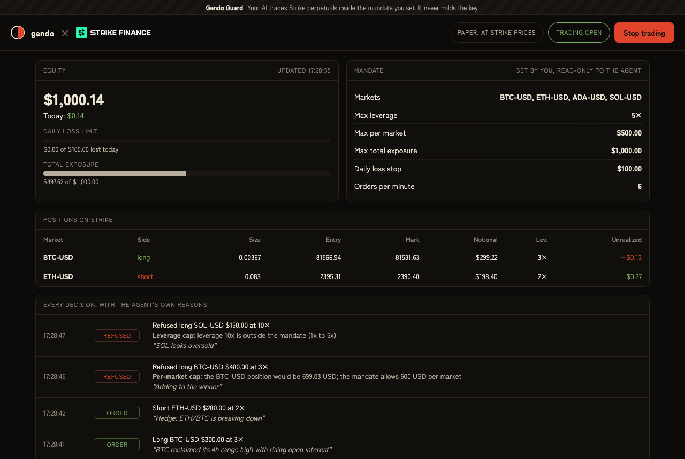

# Gendo Guard for Strike

**Let an AI agent trade Strike perpetuals without handing it the keys, or your whole account.**

You set a mandate (which markets, the maximum leverage, the largest position, the largest total exposure, a daily loss stop). Your AI (Claude Desktop, Claude Code, Cursor, or any MCP app) gets trading tools for Strike. Every order it asks for is checked against your mandate before it reaches Strike. If the day's loss hits your limit, the guard closes everything and stops new trades until you resume. You watch it all, with the agent's own reason for every trade, on a local dashboard with a stop button.

Built on [Gendo](https://gendo.cash), budgeted on-chain accounts for AI agents on Cardano, for the Strike Hackathon (October 2026).



## Why

AI agents can already trade. What stops people from letting them is that today you either give the agent your keys (and hope) or you don't use it. Strike already does half of the job: its **API wallet** keys can trade but can never withdraw. Gendo Guard does the other half: it keeps that key away from the agent and enforces your risk limits on every order.

| Risk | What stops it | How strong |
|---|---|---|
| The agent withdraws your funds | Strike: an API wallet key can trade but can't deposit or withdraw; withdrawals need your own wallet's signature and go only to your wallet | Enforced by Strike |
| The agent reads or leaks the key | The guard holds the key; the agent only sees tools (`open_position`, `close_position`...) | The agent's process never has it |
| Wrong markets, too much leverage, positions too big | The mandate, checked before every order | Enforced by the guard |
| A losing day spirals | The daily loss stop: close everything, refuse new trades until the owner resumes; survives a restart | Enforced by the guard, checked before every order and every 15 s |
| The agent unlocks itself or loosens its rules | Anyone at the dashboard can press Stop; only the owner's link resumes trading or edits the mandate, so an agent with a web-fetch tool can't | Enforced by the guard |
| Reducing risk gets blocked | Closing or shrinking a position is always allowed, even when stopped or over a limit | By design |

The guard is off-chain software: it's as trustworthy as the machine it runs on. What it never needs is withdrawal rights, because Strike never gives them to an API key. The next step (see [Roadmap](#roadmap)) puts the capital limit on-chain with Gendo's Cardano vault.

## How it works with Strike

```mermaid
sequenceDiagram
  participant AI as Your AI (MCP)
  participant G as Gendo Guard (holds the API key)
  participant S as Strike V2 API
  participant O as You (dashboard)
  AI->>G: open_position BTC-USD long $300 at 3x, "reason"
  G->>S: GET exchangeInfo, markPrice, account, positions
  G->>G: inside the mandate? (market, leverage, position, exposure, rate, daily loss)
  alt inside
    G->>S: POST /v2/leverage, POST /v2/order (market, signed with the API wallet)
    G-->>AI: placed
  else outside
    G-->>AI: refused: POSITION, "the BTC-USD position would be 699 USD; the mandate allows 500"
  end
  G-->>O: every decision, with the agent's reason
  O->>G: Stop: cancel all, close every position, lock
```

Strike endpoints used, all through Strike's Ed25519 API-wallet signing (`{METHOD}:{PATH}:{TIMESTAMP}:{NONCE}:{SHA256(body)}`):
- market data: `GET /price/v2/exchangeInfo` (markets, lot sizes, minimums), `GET /price/v2/markPrice`;
- account: `GET /v2/account` (equity for the daily loss stop), `GET /v2/positions`;
- trading: `POST /v2/leverage`, `POST /v2/order` (market orders, `reduce_only` for closes), `DELETE /v2/order/cancel-all`.

The agent's tools:

| Tool | What it does |
|---|---|
| `get_mandate` | The owner's rules, and whether trading is stopped |
| `get_account` | Equity, today's PnL, positions with unrealized PnL, and the room left: per market, in total, and before the loss stop |
| `get_price` | Strike's mark price for a market |
| `open_position` | Market order sized in USD notional, with a required reason. Waits for Strike's fill: `filled`, `partially_filled`, `not_filled` (with Strike's reason, e.g. no liquidity), or `refused` by the mandate with a code and a sentence |
| `close_position` | Close a whole position. Always works |

There is no tool to change the mandate, resume trading, deposit or withdraw.

## Run it

Needs Node 22+.

```bash
git clone https://github.com/gendo-cash/gendo-strike && cd gendo-strike && npm ci
npm test                                   # mandate, signing, guard, and the full MCP flow against Strike testnet prices
```

**Paper mode** (no key: a paper account that fills at Strike testnet's live mark prices):
```bash
bin/gendo-strike --no-mcp                  # prints the owner dashboard link
node scripts/demo-agent.mjs                # or: a scripted agent that trades and hits the limits
```

**Live on Strike testnet:**
1. Connect a wallet at [testnet.strikefinance.org](https://testnet.strikefinance.org) and fund the account.
2. Create an API wallet there (or generate an Ed25519 key and register its public key).
3. Save the private key in `~/.gendo-strike/api-key` (`chmod 600`). The guard reads it from there, so it never appears in your AI app's config or logs, and never reaches the AI. (`STRIKE_API_KEY` in the environment works too.)

**Connect your AI.** Claude Desktop (`claude_desktop_config.json`):
```json
{
  "mcpServers": {
    "strike": {
      "command": "/path/to/gendo-strike/bin/gendo-strike",
      "env": { "STRIKE_NETWORK": "testnet" }
    }
  }
}
```
Claude Code: `claude mcp add strike -- /path/to/gendo-strike/bin/gendo-strike`

The guard prints the dashboard link (`http://127.0.0.1:8711/?owner=...`) to its log, and keeps the token in `~/.gendo-strike/owner-token`. Open that link to see everything and to **edit the mandate** (markets as toggles, the limits as numbers); a change applies to the agent's next order, is checked before it's saved, and shows in the journal. Without the owner link the page is read-only: anyone there can press Stop, nobody can loosen the rules or resume. The mandate is saved in `~/.gendo-strike/mandate.json`:
```json
{ "markets": ["BTC-USD", "ETH-USD", "ADA-USD", "SOL-USD"], "maxLeverage": 5, "maxPositionUsd": 500,
  "maxExposureUsd": 1000, "maxDailyLossUsd": 100, "maxOrdersPerMinute": 6 }
```

## Tests

| Suite | What it proves |
|---|---|
| `test/mandate.test.ts` | Every rule: markets, leverage, per-market and total exposure (a flip from long to short counts the new short), rate, Strike's minimums, sizing never rounds up, a stop is reported first, closing always allowed |
| `test/strike.test.ts` | Request signing matches Strike's format, checked against the RFC 8032 Ed25519 test vector |
| `test/guard.test.ts` | Orders journaled with reasons; refusals place nothing; the daily loss stop closes everything and locks; the owner's stop and resume; a stop survives a restart; two simultaneous orders can't both pass a check meant for one |
| `test/e2e.test.ts` | An MCP client starts the guard like an AI app does, trades on Strike testnet prices, gets refused; the dashboard's stop, owner-only resume and owner-only mandate edits work, and the agent sees an edit at once |

`scripts/live-smoke.mjs` runs the same flow on a **real Strike testnet account** (with `STRIKE_API_KEY` set): a 15 USD ETH long at 2x filled on Strike and showed up as a position; adding past the per-market cap, 10x leverage and a market outside the mandate were refused; an ADA order Strike cancelled for lack of liquidity came back as `not_filled` with that reason; the position closed. All passed on Strike testnet on 23 October 2026.

Not tested yet: mainnet, Strike sub-accounts, and the daily loss stop on a live account (it's tested on the paper account, which uses the same code path).

## Roadmap

- **Capital caps on-chain, with Gendo's Cardano vault.** Owners keep funds in a Gendo vault and give the agent an allowance whose only destination is a deposit into Strike, capped per period. The chain then bounds how much capital an agent can ever put at risk, whatever the guard or the agent does. Gendo's vault, allowance and adapter system already exist on preprod ([gendo.cash](https://gendo.cash)); the missing piece is a Strike deposit adapter.
- **One Strike sub-account per agent**, so each agent's margin and PnL are isolated.
- **Builder codes**: the guard as a Strike builder, earning a fee share on the agents' volume.
- **Mandates approved by several owners** in the Gendo app, and the stop button on a phone.
- **Copy-trading guard**: the same mandate wrapped around Strike copy trading.

## Limits

- The guard is off-chain: it enforces the mandate only while it runs on a machine you trust. Strike, not the guard, is what keeps the key from withdrawing.
- Market orders only; the guard sizes from the mark price it just checked.
- Paper mode has no fees, funding or liquidations.
- The daily loss stop uses Strike's margin balance and resets at 00:00 UTC.

Apache-2.0.
